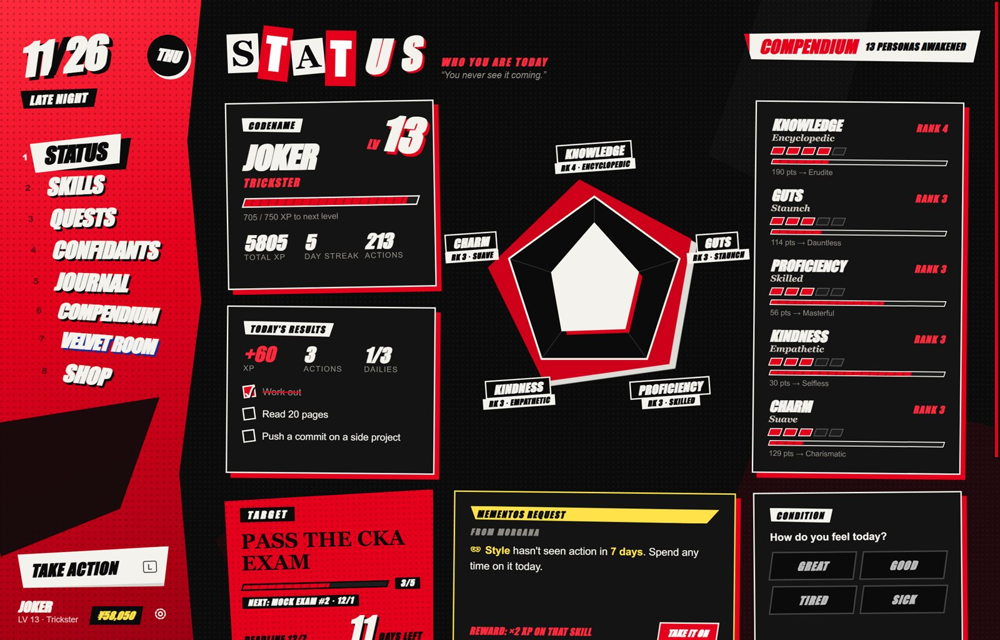
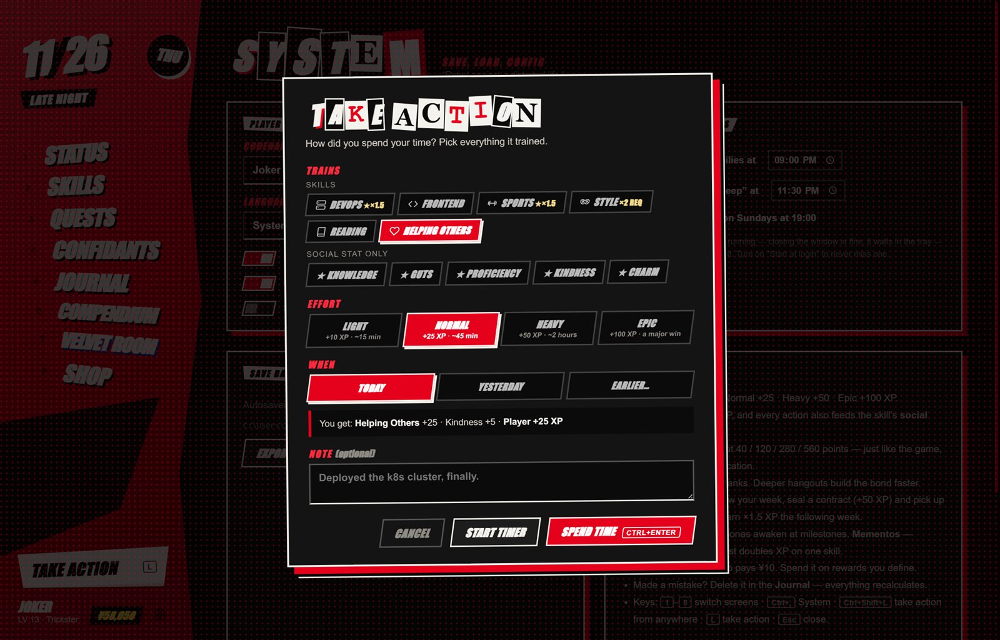
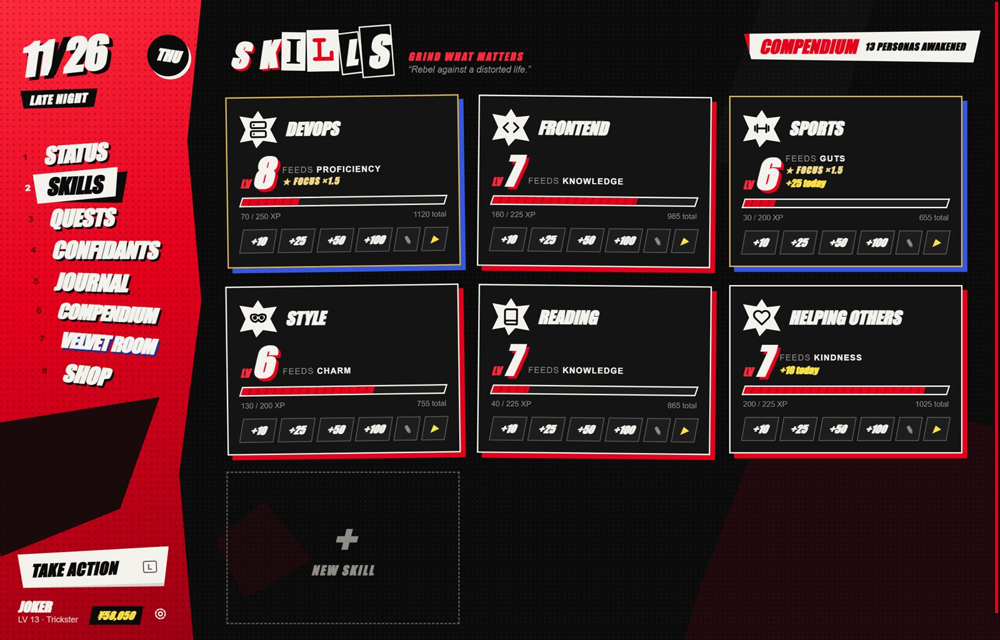
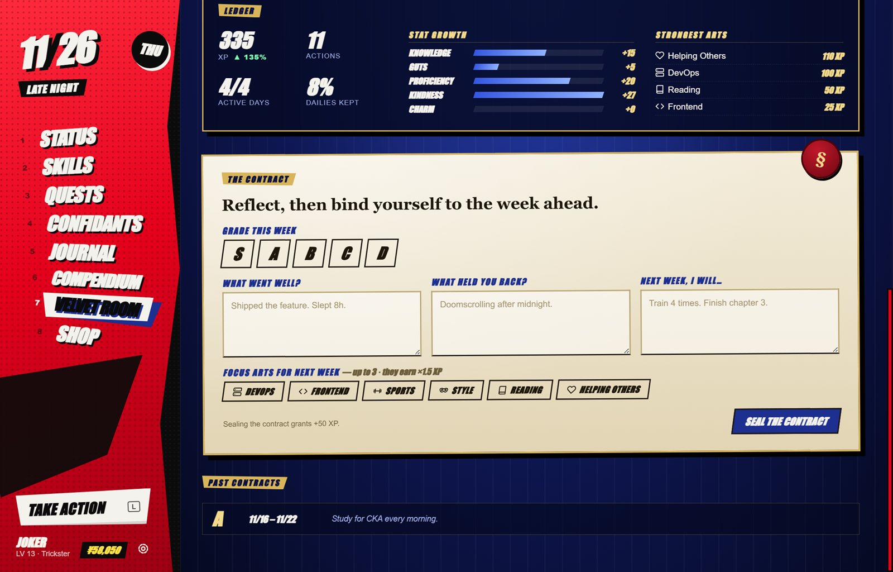
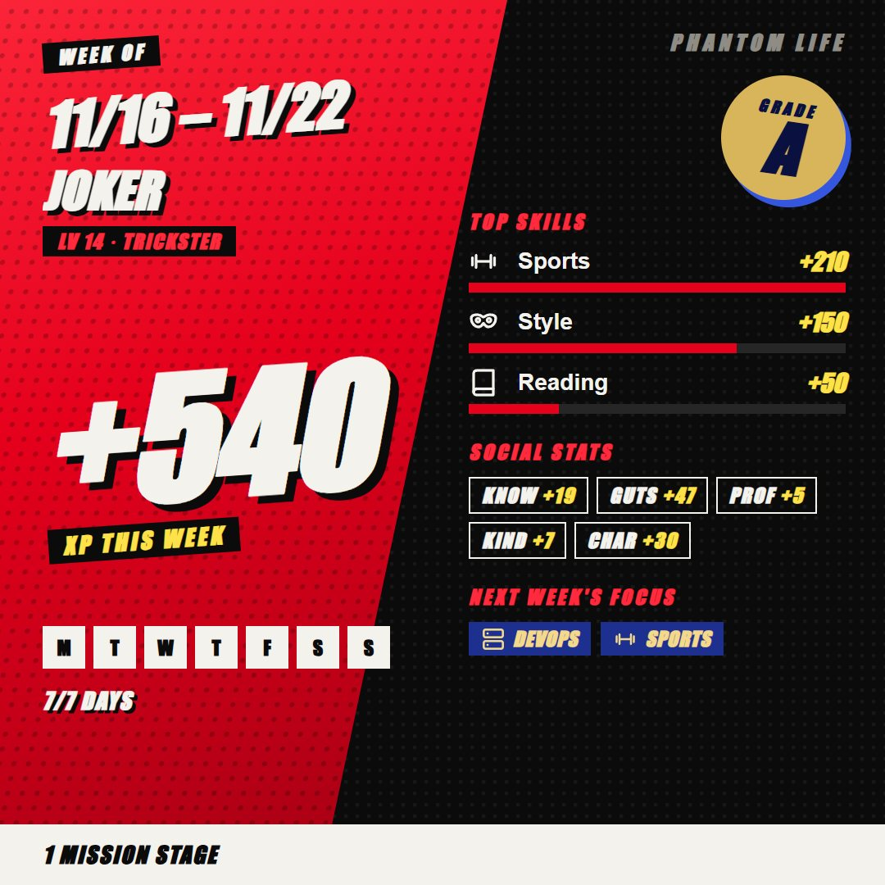
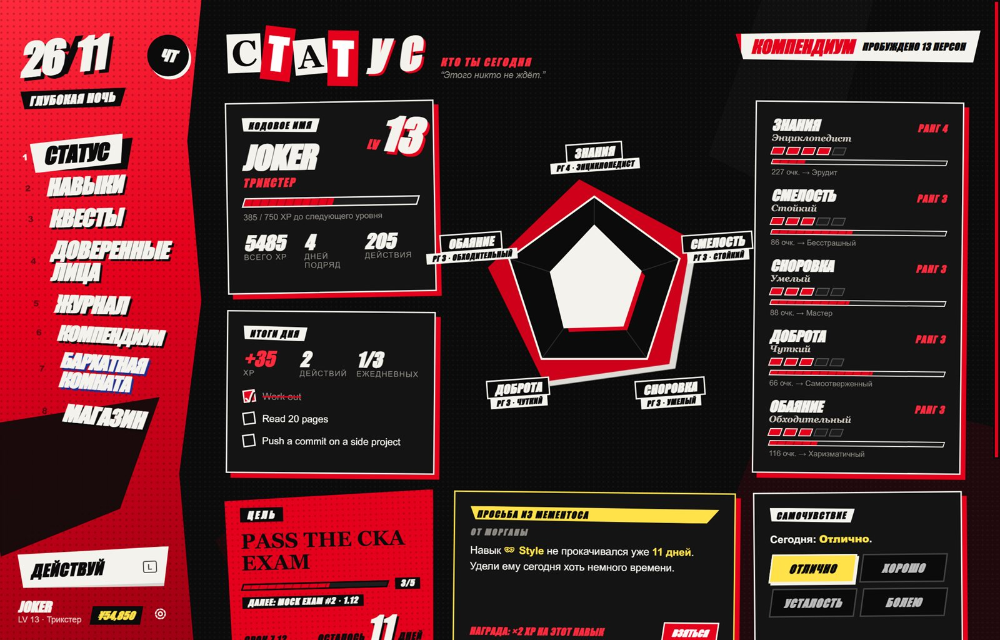
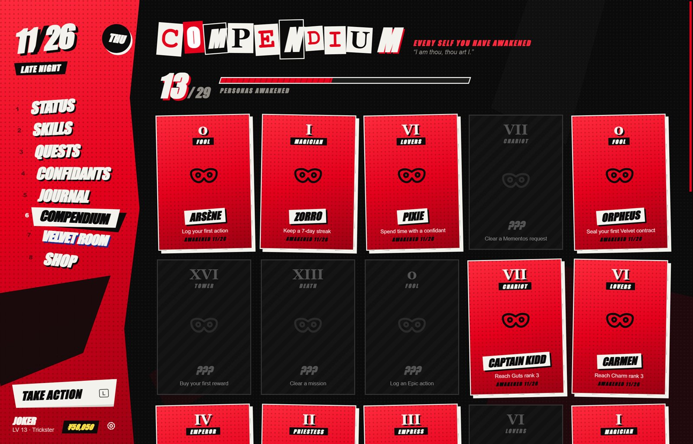

# Phantom Life

A desktop life tracker styled after Persona 5. Your real life is the game: skills level up, social
stats rank up, confidants deepen, missions have deadlines — and once a week you sit down in the
Velvet Room to look back on it.

macOS and Windows · English and Russian · everything stays on your computer: no account, no server.



## Features

**Log what you do**
- **Take action** (`L`, or `⌘⇧L` / `Ctrl+Shift+L` from any app): pick every skill or social stat the
  activity trained and how hard it was — Light +10 · Normal +25 · Heavy +50 · Epic +100 XP.
- **Focus timer**: ▶ on a skill starts it; it sits in the sidebar and the tray, survives closing the app,
  and asks whether to drop the time if you stepped away from the computer.
- Log an earlier day, undo from the toast, or edit any journal entry later — every level and rank is
  recalculated from the history.

**Grow**
- **Skills** level up from XP; each feeds one of five **social stats** — Knowledge, Guts, Proficiency,
  Kindness, Charm — with five ranks each.
- **Confidants**: the people you want to grow closer to, 10 ranks each, one arcana each. A meeting can
  include several of them.
- **Compendium**: 29 personas that awaken at milestones — streaks, ranks, missions, contracts.

**Plan**
- **Quests**: dailies with streaks (optionally on chosen weekdays), weeklies, and one-off **missions**
  with deadlines that show up as a calling card on the Status screen.
- **Mission stages**: split a mission into steps with their own deadlines; a pace marker says whether
  you're on track.
- **Mementos requests**: each day a neglected skill earns ×2 XP on its first action.

**Look back**
- **Velvet Room**: every week Igor reviews your XP pace, stat growth, neglected skills, distant
  confidants and upcoming deadlines. Grade the week, reflect, and seal a contract choosing up to three
  focus skills that earn ×1.5 XP the next week.
- **Share week**: any week as a 1080×1080 card, copied to the clipboard or saved as a PNG. Numbers only;
  your notes stay private.
- **Journal**: the full history, a month calendar, weekly charts, and how your daily condition affects
  your output.

**Reward yourself**
- **Shop**: every XP also pays ¥10. Define your own rewards and buy them with what you earned.
- **Morgana** reminds you about unfinished dailies, bedtime and the Sunday Velvet Room, with the window
  closed too.

| | |
|---|---|
|  |  |
|  |  |
|  |  |



## How it's built

Electron with plain HTML, CSS and JavaScript — no framework, no bundler, no runtime dependencies.

- **Progress is event-sourced.** The journal is the only source of truth: XP, levels, ranks and ¥ are
  recalculated from it on every render. Deleting or editing an entry undoes it exactly, and saves from
  older versions keep loading through readers that understand every entry format.
- **Locked-down renderer.** Context isolation, a sandbox and a strict Content Security Policy; the page
  reaches the system only through a small `window.api` bridge, and navigation, new windows and web
  permissions are blocked.
- **Two languages without a library.** English text is the key, Russian plurals come from
  `Intl.PluralRules`, and names the game wrote into your save switch language with the interface.
- **Images from HTML.** The week card is rendered in a hidden window and captured to the clipboard; the
  Windows installer's animated splash and the macOS installer's background are drawn in HTML too.
- **Installers.** Windows: Squirrel — one double-click, no wizard, updates in place. macOS: a disk image.
- **Tests drive the real app.** 71 Playwright tests launch Electron with a throwaway save: behaviour,
  axe-core accessibility on every screen, window security, and a check that no English is left in the
  Russian interface.

## Install

There are no prebuilt downloads yet: build the installer from source. The app lives in
[`gamified-life-tracker/`](gamified-life-tracker); you need [Node.js](https://nodejs.org) 20+.

```bash
cd gamified-life-tracker
npm install
```

**Windows**

```bash
npm run install_app:win
```

Builds `dist/squirrel/Phantom Life Setup.exe` and runs it: an animated splash plays for a few seconds
while it installs (just for you, no admin rights), and the app opens. It adds Phantom Life to the Start
menu, the desktop, and Settings → Apps. A newer installer updates in place; your progress survives
updates and uninstalling. Closing the window keeps the app in the tray; quit from the tray icon.

**macOS** (Apple Silicon)

```bash
npm run package:mac
open "dist/Phantom Life 1.0.0 arm64.dmg"
```

Drag Phantom Life onto Applications. The image is ad-hoc signed, not notarized: on another Mac, allow
the first launch in System Settings → Privacy & Security → Open Anyway. `npm run install_app` builds the
app and copies it straight into `/Applications` instead.

Reminders, the global shortcut and the tray run only in the installed app.

## Development

```bash
cd gamified-life-tracker
npm start    # run from source
npm test     # end-to-end tests
```

| File | What's in it |
|---|---|
| `main.js` | Main process: window, saving, backups, tray, global shortcut, reminders, week card rendering |
| `preload.js` | The `window.api` bridge between the page and the main process |
| `src/app.js` | Game rules, state and every screen |
| `src/i18n.js` | Translation helpers and the Russian text |
| `src/styles.css` | The look |
| `tests/` | Playwright tests |
| `build/installer/` | Installer artwork: `splash.html` → `npm run splash`, `dmg.html` → `npm run dmg-background` |

## Your data

Saved after every action, with a daily backup (last 14 days) in `backups/` next to it.
Export and import from the System screen (gear icon).

- macOS: `~/Library/Application Support/Phantom Life/save.json`
- Windows: `%APPDATA%\Phantom Life\save.json`

## Authors

[@aayafrontenda](https://github.com/aayafrontenda) · [@jumazes](https://github.com/jumazes)

Phantom Life is an unofficial fan project, not affiliated with or endorsed by ATLUS or SEGA. Persona
and related names belong to their owners.
