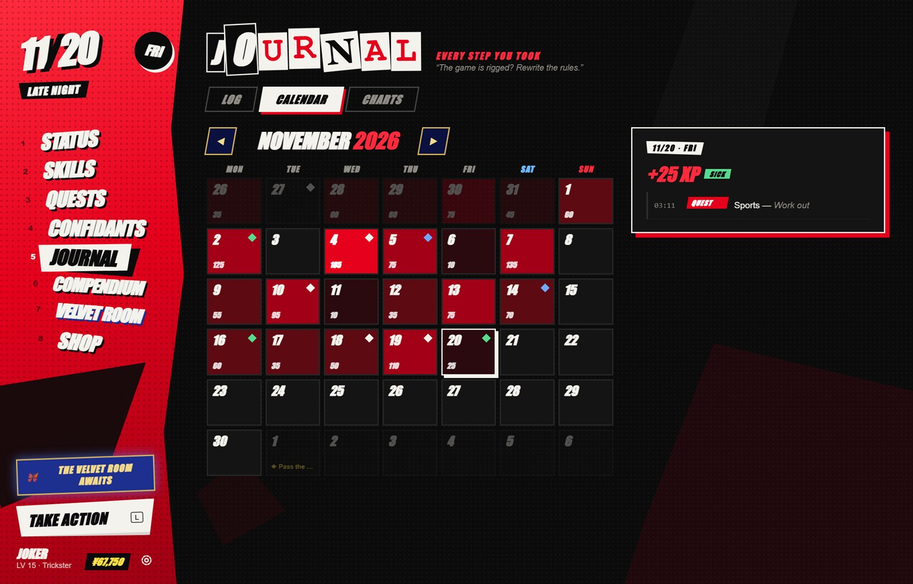

# Phantom Life

A desktop life tracker styled after Persona 5. Your real life is the game: skills level up, social
stats rank up, confidants deepen, missions have deadlines — and once a week you sit down in the
Velvet Room to look back on it.

Runs on **macOS** and **Windows**. Everything stays on your computer: no account, no server.


## What's inside

| | |
|---|---|
|  |  |
| **Take action** — log what you did, pick every skill it trained and how hard it was. | **Skills** level up from XP; each one feeds a social stat. |
|  |  |
| **Journal** — full history, a month calendar, weekly charts. | **Velvet Room** — a weekly review with a contract for the week ahead. |


- **New game**: the first launch walks you through creating your character — a codename, the parts
  of your life you want to grow (each becomes a skill), and a few starter quests. Nothing is saved
  until you press Start; System → New game runs it again, and you can still go back.
- **Take action** (`L`): pick every skill (or social stat) the activity trained, plus an effort level —
  Light +10 · Normal +25 · Heavy +50 · Epic +100 XP. Each chosen skill gets the full XP; each social
  stat is credited once even if several chosen skills feed it; player XP counts once.
- **Focus timer**: press ▶ on a skill (or Start timer in Take action) and get to work. The clock sits
  in the sidebar and on the tray icon, survives closing the app, and can be paused. Stop logs it with
  the minutes and a matching effort. Step away from the computer for 10+ minutes and it asks whether
  to drop that time.
- Forgot to log something? Pick **Yesterday** or an earlier date under *When*. Logged the wrong thing?
  Hit **Undo** on the toast right after.
- **Skills** level up from XP. Each skill feeds one **social stat** (XP ÷ 5 points).
- **Social stats** — Knowledge, Guts, Proficiency, Kindness, Charm — have 5 ranks, at
  40 / 120 / 280 / 560 points.
- **Quests**: daily (with streaks, optionally on chosen weekdays only), weekly (reset Monday), and
  one-off **missions** with deadlines that show up as a calling card on the Status screen.
- **Mission stages**: break a mission into steps, each with an optional deadline. Every step pays XP,
  the last one clears the mission, and a pace marker says whether you're on track for the deadline.
- **Confidants**: people you want to grow closer to. 10 ranks each, pick their arcana. Time together
  grows their stat and can also train skills. One meeting can include several confidants.
- **Velvet Room**: Igor reviews your week (XP pace, stat growth, neglected skills, distant confidants,
  upcoming deadlines). Grade the week, reflect, and seal a contract (+50 XP) choosing up to 3
  **focus skills** that earn ×1.5 XP the following week. **Share week** turns any week into a
  1080×1080 card — copy it to the clipboard or save a PNG. It shows numbers only; your notes stay private.
- **Shop**: every XP also pays ¥10. Define your own rewards and buy them with what you earned.
- **Morgana**: notifications for unfinished dailies, bedtime and the Sunday Velvet Room. They keep
  working with the window closed.
- **Compendium**: 29 personas that awaken at milestones (streaks, ranks, missions, contracts…).
- **Mementos requests**: each day a neglected skill is picked — the first action on it earns ×2 XP.
- **Condition**: log how you feel each day and see how it affects your output.
- **Journal**: edit an entry (✎) to fix what it trained, the effort, the day or the note, or delete it to undo
  it — every level and rank is recalculated from the history.
- **English and Russian**: follows the system language; switch on the title screen or in System. Tray menu and
  reminders follow too.

**Keys:** `1`–`8` switch screens · `L` take action · `⌘⇧L` / `Ctrl+Shift+L` take action from any app ·
`⌘,` / `Ctrl+,` settings · `⌘↵` / `Ctrl+Enter` submit · `Esc` close.

## Install

The app lives in [`gamified-life-tracker/`](gamified-life-tracker). You need [Node.js](https://nodejs.org) 20+.

```bash
cd gamified-life-tracker
npm install
```

**Windows**

```bash
npm run install_app:win
```

Builds `dist/squirrel/Phantom Life Setup.exe` and runs it. No wizard: double-click, an animated splash
plays for a few seconds while it installs (just for you, no admin rights), and the app opens. It adds
Phantom Life to the Start menu, the desktop, and Settings → Apps for uninstalling. Running a newer
installer updates in place; your progress survives updates and uninstalling. The installer is a single
file you can pass to someone else. Closing the app's window keeps it in the system tray; quit from the
tray icon.

The splash is drawn in `build/installer/splash.html`; after changing it, run `npm run splash` to
regenerate `build/installer/loading.gif`.

**macOS** (Apple Silicon)

```bash
npm run package:mac
open "dist/Phantom Life 1.0.0 arm64.dmg"
```

Builds a disk image: drag Phantom Life onto Applications. The image is a single file you can pass to
someone else. It is ad-hoc signed, not notarized: on another Mac, the first launch is blocked until you
allow it in System Settings → Privacy & Security → Open Anyway. Replacing the app keeps your progress
(it lives in `~/Library/Application Support/Phantom Life`).

The window's background is drawn in `build/installer/dmg.html`; after changing it, run
`npm run dmg-background` (on any system) to regenerate the PNGs.

`npm run install_app` still builds the app and copies it straight into `/Applications`, without an image.

Reminders, the global shortcut and the tray run only in the installed app.

## Development

```bash
cd gamified-life-tracker
npm start    # run from source
npm test     # end-to-end tests: launches the real app with a throwaway save
```

Plain HTML, CSS and JavaScript on Electron — no framework, no build step.

| File | What's in it |
|---|---|
| `main.js` | Main process: window, saving, backups, tray, global shortcut, notifications |
| `preload.js` | The `window.api` bridge between the page and the main process |
| `src/app.js` | Game rules, state and every screen |
| `src/styles.css` | The look |
| `tests/` | Playwright tests: behaviour, accessibility on every screen, window security |

Progress is never stored directly: XP, levels and ranks are recalculated from the journal on every
render, which is why deleting an entry cleanly undoes it.

## Your data

Saved after every action, with a daily backup (last 14 days) in `backups/` next to it.
Export and import from the System screen (gear icon).

- macOS: `~/Library/Application Support/Phantom Life/save.json`
- Windows: `%APPDATA%\Phantom Life\save.json`
